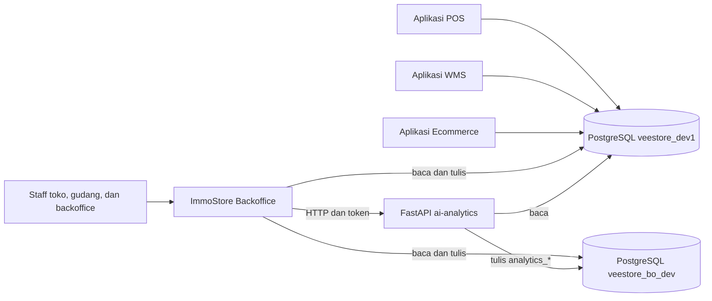
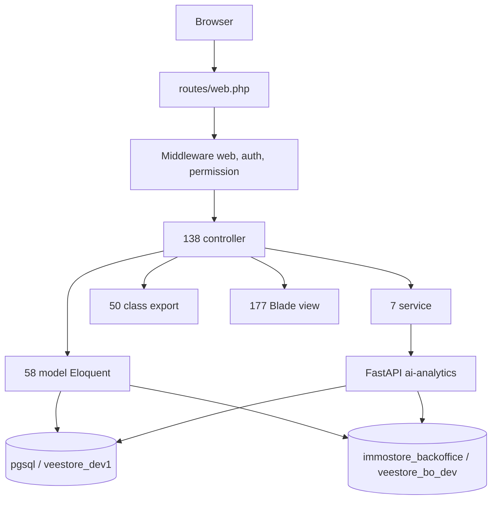
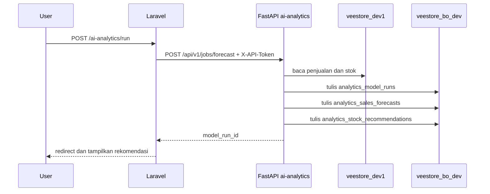
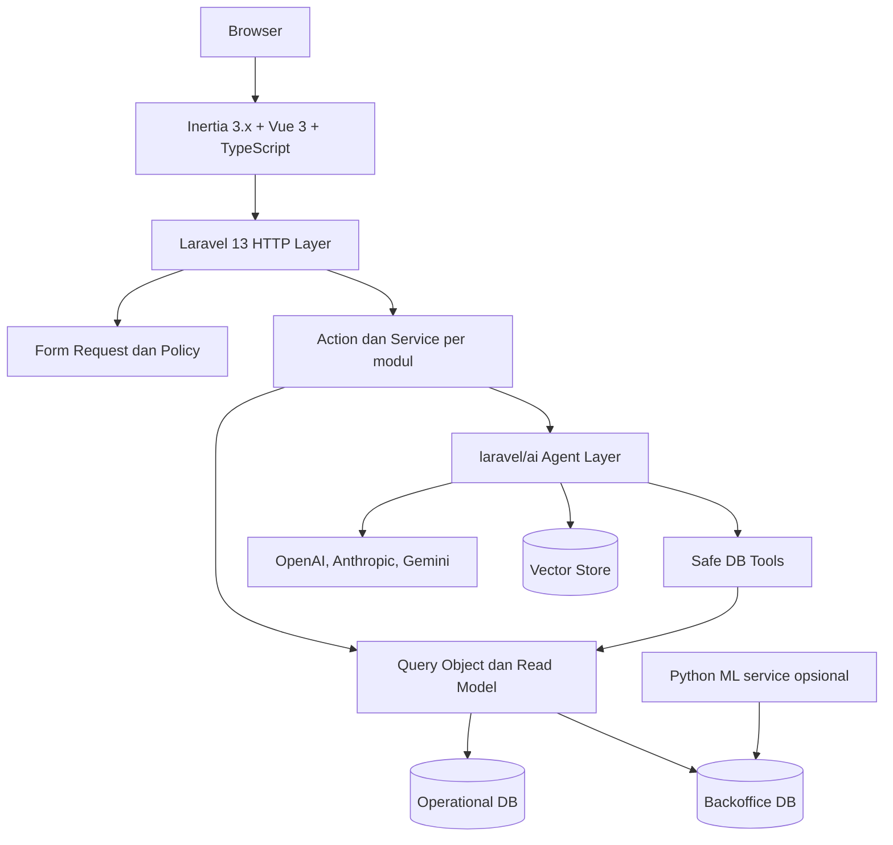

# Arsitektur ImmoStore Backoffice

Status: baseline v0.1
Tanggal: 2026-10-31
Commit: `19b9330` (`main`)
Lingkup: aplikasi `immostore-backoffice`, database operasional `veestore_dev1`, database backoffice `veestore_bo_dev`, dan service `services/ai-analytics`.

Dokumen pendamping:

- `docs/erd.md`: ERD per domain dan kamus tabel inti.
- `docs/route-inventory.md`: inventaris 305 route aplikasi per modul.

## 1. Ringkasan eksekutif

1. Sistem ini adalah **monolith Laravel admin backoffice** di atas database operasional yang dipakai bersama oleh POS, WMS, dan ecommerce.
2. Laravel memakai **dua koneksi PostgreSQL**: `pgsql` untuk data operasional dan `immostore_backoffice` untuk data milik backoffice (role, permission, audit, export, analytics).
3. Skema operasional **bukan milik repo ini**. Repo hanya punya 12 migration (khusus database backoffice dan satu kolom voucher di DB operasional), sementara database punya `goose_db_version` dengan 102 versi dan 132 tabel.
4. Integrasi AI saat ini adalah **service Python FastAPI terpisah** dengan metode moving average, bukan LLM. Laravel memanggilnya lewat HTTP dan menampilkan rekomendasi stok.
5. Beban terbesar ada di controller: 37.541 LOC, 1.133 query mentah, dan beberapa controller di atas 1.000 baris. Ini yang harus dirapikan sebelum atau selama upgrade.

## 2. Stack saat ini dan target

| Aspek | Saat ini | Target |
|---|---|---|
| Framework | Laravel 13.39.0 (sudah upgrade) | Laravel 13.x |
| PHP | 8.4.26 | 8.4 |
| UI | Blade + Materio + Bootstrap 5 + jQuery, pilot AI Analytics sudah Inertia | Inertia 3.x + Vue 3 + TypeScript, Vite |
| Build | Laravel Mix / webpack | Vite |
| AI | FastAPI Python, moving average | `laravel/ai` untuk agent, tool, structured output, embedding |
| Antrian | `sync` | Redis + Horizon |
| Permission | Spatie Permission 6.25 | Spatie Permission versi yang kompatibel Laravel 13 |
| Test | 6 file test | PHPUnit/Pest + Larastan + Pint di CI |
| Database | 2 koneksi PostgreSQL | Tetap 2 koneksi, nama dan kontrak diperjelas |

Catatan versi: Laravel 13 dirilis Maret 2026 dan minimal PHP 8.3. Paket `laravel/ai` v1.x membutuhkan PHP 8.3+ dan Illuminate 12 atau 13. Kombinasi target yang aman adalah Laravel 13.x + PHP 8.4 + `laravel/ai` v1.x.

## 3. Konteks sistem



Implikasi:

- Backoffice bukan pemilik tunggal data. Perubahan skema operasional harus dikoordinasikan dengan pemilik POS, WMS, dan ecommerce.
- Backoffice menulis ke tabel operasional (master data, approval, void, opname), jadi tidak bisa diperlakukan sebagai aplikasi read-only.
- Data role dan permission berada di database backoffice, sedangkan user berada di database operasional. Relasi `model_has_roles.model_id` ke `users.id` bersifat lintas database dan tidak punya foreign key.

## 4. Arsitektur runtime saat ini



Pola yang dominan:

- Controller memuat query, validasi, transaksi, dan penyusunan view sekaligus.
- 78 controller memakai `DB::` langsung. Total 1.182 pemakaian `DB::` dan 1.133 query mentah (`selectRaw`, `whereRaw`, `DB::table`, dan sejenisnya).
- Hanya 40 controller memakai `$request->validate()` atau `Validator::make()`. Sisanya memvalidasi manual atau tidak eksplisit.
- Hanya 7 service, yaitu `AIAnalyticsService`, `BranchOperationNotificationService`, `EcommerceOrderStockAlertService`, `ReportExportService`, `Settings`, `StockReservationService`, dan `VillageGeocoder`.
- Hanya 1 job (`GenerateReportExport`), tetapi `QUEUE_CONNECTION=sync`, sehingga job berjalan inline.

## 5. Peta modul

Total route aplikasi: 307. Total controller aplikasi: 96 controller bisnis dan 1 base `Controller`. Controller template Materio sudah dihapus pada fase 5.

| Modul | Route | Controller | LOC | Query mentah | Model utama | Service | Tabel utama |
|---|---:|---:|---:|---:|---|---|---|
| Master Data | 114 | 26 | 10.929 | 126 | Product, Item, Brand, ProductCategory, Supplier, Store, Warehouse, Location, Voucher, Promo, Membership | Settings | products, items, brands, product_categories, suppliers, stores, warehouses, locations, vouchers, promos, memberships |
| Monitoring | 111 | 44 | 18.639 | 740 | Item, StoreItem, WarehouseItem, Payment, EcommerceOrder, Customer | StockReservationService, Settings | store_items, warehouse_items, store_carts, payments, ecommerce_orders, store_opnames, stock_barriers |
| Reports | 31 | 6 | 3.298 | 162 | Customer, StoreOrder, StoreReturn, Voucher, Product | StockReservationService | store_orders, store_returns, store_receivable_invoices, voucher_usages |
| Management | 13 | 5 | 460 | 5 | User, Role, Permission | - | users, roles, permissions, model_has_roles, role_has_permissions |
| Settings | 8 | 4 | 240 | 0 | CustomerLoyaltyPoint, CustomerLoyaltyPointMutation | Settings | app_settings, customer_loyalty_points, membership_benefits |
| Branch Operations | 4 | 2 | 402 | 12 | StoreVoucherRequest, StoreLabelPrintRequest | - | store_voucher_requests, store_label_print_requests |
| Ecommerce | 4 | 1 | 364 | 5 | EcommerceOrder, EcommerceOrderDetail | EcommerceOrderStockAlertService, StockReservationService | ecommerce_orders, ecommerce_order_details, order_shipments |
| Loyalty | 3 | 3 | 181 | 3 | CustomerLoyaltyPoint, CustomerLoyaltyPointMutation, Visit | - | customer_loyalty_points, customer_loyalty_point_mutations, store_customer_visits |
| AI Analytics | 3 | 1 | 69 | 4 | ModelRun, SalesForecast, StockRecommendation | AIAnalyticsService | analytics_model_runs, analytics_sales_forecasts, analytics_stock_recommendations |
| Notifications | 4 | 1 | 78 | 0 | - | BranchOperationNotificationService | store_returns, store_voucher_requests, store_label_print_requests, notification_reads |
| Report Export | 3 | 1 | 32 | 0 | - | ReportExportService | report_exports, report_export_jobs |
| Dashboard | 1 | 1 | 1.873 | 71 | Banyak model dan query langsung | - | Lintas domain |
| Auth | 6 | 1 | 347 | 2 | User | - | users, session_logs |

### 5.1 Controller terbesar

| Controller | LOC | Query mentah | Modul |
|---|---:|---:|---|
| `dashboard/Analytics` | 1.873 | 71 | Dashboard |
| `Reports/CrmController` | 1.432 | 87 | Reports |
| `Monitoring/TrackingBarangController` | 1.066 | 77 | Monitoring |
| `MasterData/LocationwarehouseController` | 939 | 36 | Master Data |
| `Monitoring/OmsetKotorSalesController` | 931 | 25 | Monitoring |
| `MasterData/LocationstoreController` | 891 | 33 | Master Data |
| `Monitoring/OmsetCabangController` | 808 | 26 | Monitoring |
| `Monitoring/MonitoringDataCustomerController` | 792 | 29 | Monitoring |
| `Reports/OrderCabangController` | 783 | 16 | Reports |
| `Monitoring/StoreStockOpnameReportController` | 769 | 23 | Monitoring |

### 5.2 Dependency matrix ringkas

| Controller | Bergantung pada model | Bergantung pada service | Query langsung |
|---|---|---|---|
| `AIAnalytics/AIAnalyticsController` | ModelRun, SalesForecast, StockRecommendation, Store | AIAnalyticsService | Ya |
| `Ecommerce/EcommerceOrderController` | EcommerceOrder, EcommerceOrderDetail, Store, Warehouse | EcommerceOrderStockAlertService, StockReservationService | Ya |
| `Reports/OrderCabangController` | StoreOrder, StoreOrderDetail, Product | StockReservationService | Ya |
| `Reports/CrmController` | Customer, CustomerLoyaltyPoint, StoreVisit | - | Ya, 87 query mentah |
| `Monitoring/StokWmsController` | WarehouseItem, Item, Product | StockReservationService | Ya |
| `Monitoring/StokPercabangController` | StoreItem, Item, Product | StockReservationService | Ya |
| `Monitoring/CustomerLoyaltyPointsReportController` | CustomerLoyaltyPoint, CustomerLoyaltyPointMutation | Settings | Ya |
| `Settings/PointSettingController` | AppSetting | Settings | Tidak |
| `NotificationStatusController` | - | BranchOperationNotificationService | Tidak |
| `ReportExportController` | - | ReportExportService | Tidak |

### 5.3 Modul yang paling terikat

| Modul | Alasan |
|---|---|
| Dashboard dan Monitoring | Paling banyak query lintas tabel dan paling banyak duplikasi logika laporan |
| Reports | Query mentah besar, beberapa laporan menghitung ulang aturan bisnis yang sama |
| Master Data | Banyak CRUD, tetapi paling aman untuk diekstrak ke service karena domainnya jelas |
| Management | Sudah memakai koneksi backoffice secara eksplisit, tetapi pivot role masih diakses dengan query manual |
| AI Analytics | Boundary paling jelas, cocok dijadikan pilot integrasi `laravel/ai` |

## 6. Domain data

Database operasional: 132 tabel, 1.382 kolom, 317 foreign key, 241 nilai enum dalam 60 tipe enum PostgreSQL. Semua primary key memakai UUID.

| Domain | Tabel inti | Pemilik logika |
|---|---|---|
| Katalog | products, product_prices, product_images, product_specifications, brands, product_categories, units | Master Data |
| Inventori | items, item_conditions, warehouse_items, store_items, stock_reservations | WMS dan POS |
| Inbound | warehouse_inbounds, warehouse_inbound_details, store_inbounds, store_inbound_details | WMS |
| Outbound | warehouse_outbounds, warehouse_outbound_details, store_outbounds, store_outbound_details | WMS dan POS |
| QC dan opname | warehouse_qc, store_qc, warehouse_stock_opnames, store_opname_sessions, store_opname_session_items | WMS |
| Penjualan toko | store_customer_visits, store_carts, store_cart_details, store_visit_payments, payments, cashier_sessions | POS |
| Ecommerce | ecommerce_orders, ecommerce_order_details, ecommerce_carts, order_shipments, order_shipment_events | Ecommerce |
| Loyalty dan CRM | customers, memberships, customer_memberships, customer_loyalty_points, customer_loyalty_point_mutations, referrals | POS dan backoffice |
| Promo dan voucher | promos, discounts, discount_products, discount_rules, vouchers, voucher_codes, voucher_usages | Backoffice |
| Partner dan paylater | partners, partner_credit_tiers, partner_invoice_batches, partner_invoice_batch_items, store_receivable_invoices, fraud_alerts | Backoffice |
| Retur dan void | store_returns, store_return_details, void_transactions, void_transaction_items | POS dan WMS |
| SDM toko | store_attendances, store_attendance_shifts, store_shift_schedules, store_shift_schedule_details | Backoffice |
| Backoffice | users, roles, permissions, model_has_roles, business_audit_logs, report_exports, notification_reads | Backoffice |
| Analytics | analytics_model_runs, analytics_sales_forecasts, analytics_stock_recommendations | AI service dan backoffice |

ERD lengkap ada di `docs/erd.md`. Relasi lintas database tidak digambarkan sebagai foreign key karena PostgreSQL tidak bisa menegakkannya.

## 7. Integrasi AI saat ini

Alur:



Karakteristik:

- Model: moving average 28 hari, tren 7 hari, horizon 7 hari.
- Kualitas data: minimal 14 hari histori dan 7 hari penjualan.
- Output: forecast per channel, per store atau warehouse, per produk, plus rekomendasi restock dan risk level.
- Belum ada LLM, embedding, vector store, tool calling, atau agent.
- Service Python membaca dua database langsung dengan kredensial sendiri.

Titik kuat: boundary service sudah jelas dan output sudah terstruktur. Titik lemah: model masih sederhana, tidak ada evaluasi akurasi, dan tidak ada mekanisme tanya jawab data.

## 8. Temuan dan risiko

| Tingkat | Temuan | Bukti | Dampak | Arah perbaikan |
|---|---|---|---|---|
| Tinggi | Skema operasional tidak dikelola repo | 12 migration vs 102 versi Goose, 132 tabel | Upgrade dan refactor berisiko breaking change dari aplikasi lain | Dokumentasikan kontrak skema, buat read model, koordinasi pemilik DB |
| Tinggi | Business logic di controller | 37.541 LOC, 1.133 query mentah, 78 controller memakai `DB::` | Sulit dites, sulit dipindah ke Inertia, rawan duplikasi | Ekstrak Action/Service dan Query Object per modul |
| Tinggi | Relasi user lintas database tanpa FK | `users` di `veestore_dev1`, `roles` dan pivot di `veestore_bo_dev` | Integritas data tidak terjaga, sulit diuji | Tetapkan aturan akses, validasi di aplikasi, pertimbangkan konsolidasi |
| Tinggi | Cakupan permission tidak merata | 299 route butuh auth, hanya 125 yang punya middleware permission | Risiko akses tidak sah | Audit permission per route, tambahkan Policy |
| Sedang | Antrian sinkron | `QUEUE_CONNECTION=sync`, ada job export | Request export berat memblokir response | Aktifkan Redis dan Horizon |
| Sedang | Test sangat sedikit | 6 file test | Refactor dan upgrade tanpa jaring pengaman | Tambah feature test untuk alur kritis |
| Sedang | Dua koneksi bercampur di model | `SourceProduct extends Product` dengan koneksi berbeda | Risiko query ke DB yang salah | Pisahkan model operasional dan model backoffice |
| Sedang | Utang frontend | jQuery dan Blade tersebar di 177 view | Sulit dimodernisasi bertahap | Inertia per modul, mulai dari modul read-only |
| Rendah | File sisa | `routes/web copy.php`, `softDeletesTz()`, `test_pg.php` | Kebingungan dan noise | Hapus setelah diverifikasi |
| Rendah | PSR-4 violation | Beberapa class tidak sesuai namespace | Autoload skip | Perbaiki nama file dan namespace |

## 9. Target arsitektur

Prinsip: **modular monolith**, bukan microservices. Domain masih terlalu terikat lewat satu database dan transaksi lintas tabel.



### 9.1 Struktur modul yang dituju

```text
app/
  Domain/
    Catalog/
    Inventory/
    Sales/
    Ecommerce/
    Loyalty/
    Promotion/
    Partner/
    Workforce/
    Reporting/
    Analytics/
  Http/
    Controllers/
    Requests/
    Resources/
  Models/
    Operational/
    Backoffice/
```

Setiap modul minimal punya:

- `Actions` untuk satu use case.
- `Data` atau DTO untuk input dan output.
- `Queries` untuk query baca yang kompleks.
- `Policies` untuk otorisasi.
- `Tests` untuk alur utama.

Status implementasi: pilot `Catalog` dan `Analytics` sudah berjalan. AI Analytics sudah memakai Inertia, Vue 3, TypeScript, dan Vite. Agent `SalesAnalyst` dengan tool forecast dan rekomendasi stok sudah berjalan memakai `laravel/ai`. Detail ada di `docs/phase-2-module-foundation.md`, `docs/phase-3-inertia-pilot.md`, dan `docs/phase-4-ai-sdk.md`. Modul lain belum dimigrasikan.

### 9.2 Aturan boundary database

- `operational`: koneksi read-write untuk master data dan aksi operasional.
- `backoffice`: koneksi read-write untuk role, permission, audit, export, dan analytics.
- `analytics_read`: role read-only untuk AI dan laporan berat.
- Semua query lintas database harus lewat service, bukan relasi Eloquent.
- Jangan memakai `DB::table()` di controller setelah modul dimigrasikan.

### 9.3 Frontend Inertia

- Vite menggantikan Laravel Mix.
- Inertia 3.x + Vue 3 + TypeScript.
- Layout Materio dipertahankan sebagai basis visual, tetapi komponen Bootstrap dan jQuery diganti bertahap.
- Migrasi per modul, bukan sekaligus. Modul read-only lebih dulu: Monitoring, Reports, Dashboard, AI Analytics.
- Selama transisi, Blade dan Inertia hidup berdampingan.

### 9.4 Lapisan AI

- `laravel/ai` menjadi lapisan orkestrasi: agent, tool, structured output, conversation.
- Agent tidak boleh mengeksekusi SQL bebas. Akses data lewat tool yang sudah dibatasi dan read-only.
- Forecasting sederhana bisa dipindah ke PHP. Python tetap dipertahankan hanya jika butuh training model yang lebih berat.
- Tambahkan evaluasi akurasi sebelum mengganti model moving average.

Implementasi pilot:

- Agent `App\Ai\Agents\SalesAnalyst` memakai `SalesAnalyst` prompt dan dua tool.
- Tool `LatestForecastSummary` mengembalikan agregat model run.
- Tool `StockRiskRecommendations` mengembalikan rekomendasi restock tanpa data pribadi.
- Halaman `/ai-assistant` memakai Inertia dan Vue.
- Detail ada di `docs/phase-4-ai-sdk.md`.

### 9.5 Kinerja untuk volume transaksi besar

Pilihan Vue atau React tidak menentukan kemampuan server menangani jutaan transaksi. Keduanya hanya menerima JSON dari Inertia. Beban ditentukan oleh query, ukuran payload, cache, dan arsitektur baca.

Aturan yang harus dipegang:

- Jangan pernah mengirim data transaksi mentah dalam jumlah besar sebagai props Inertia. Gunakan pagination server-side, filter, dan sorting di query.
- Untuk dashboard, hitung agregat di read model atau materialized view, bukan saat request. Refresh terjadwal, lalu cache hasilnya di Redis.
- Gunakan deferred props Inertia untuk widget berat, dan partial reload untuk polling. Jangan reload seluruh halaman.
- Export dan laporan berat masuk queue Redis dan Horizon. Request hanya membuat job, bukan menunggu file selesai.
- Query laporan berat diarahkan ke read replica. Operasi tulis tetap ke primary.
- Indeks wajib ada pada kolom filter dan join: foreign key, tanggal transaksi, status, store_id, product_id.
- Untuk tabel histori besar seperti `payments`, `store_cart_details`, `items`, dan `order_shipment_events`, pertimbangkan partitioning berdasarkan waktu dan indeks BRIN.
- Gunakan PgBouncer untuk connection pooling, lalu Laravel Octane dengan FrankenPHP bila throughput HTTP menjadi batas.
- Pantau slow query, ukuran payload Inertia, dan waktu render. Optimasi berdasarkan angka, bukan asumsi.

Rekomendasi frontend: Vue 3 + TypeScript + Inertia 3.x. Alasannya bukan performa runtime yang jauh berbeda, tetapi ekosistem Laravel, ukuran bundle lebih kecil, dan kompleksitas form serta tabel admin lebih mudah dikelola. React tetap valid jika tim sudah kuat di React.

## 10. Rencana migrasi

| Fase | Fokus | Keluaran | Kriteria selesai |
|---|---|---|---|
| 0 | Baseline | Dokumen arsitektur, ERD, inventaris route, dependency matrix | Dokumen disetujui |
| 1 | Platform | Laravel 13, PHP 8.4, update dependency, CI dasar | Aplikasi berjalan, test lama lulus |
| 2 | Fondasi | Struktur modul, Form Request, Policy, Query Object untuk 2 modul pilot | Tidak ada `DB::` baru di modul pilot |
| 3 | Frontend | Inertia + Vite untuk Monitoring, Reports, Dashboard | Satu modul production-ready |
| 4 | AI | `laravel/ai`, safe tools, embedding, evaluasi forecast | Satu agent internal berjalan |
| 5 | Konsolidasi | Hapus controller template, job queue, test coverage naik | Utang teknis utama turun |

Upgrade framework sudah dijalankan di branch `chore/laravel-13-upgrade` dari Laravel 10 langsung ke Laravel 13.39.0. Untuk production, tetap disarankan rollout bertahap dan validasi per modul. Catatan lengkap ada di `docs/upgrade-laravel-13.md`.

Status per 2026-11-01:

- Fase 0, 1, dan 2 selesai.
- Fase 3 berjalan sebagai pilot AI Analytics.
- Fase 4 berjalan sebagai pilot agent `SalesAnalyst` dan halaman `/ai-assistant`.
- Fase 5 selesai untuk lingkup awal: report export dan queue sudah diperbaiki, seluruh test suite lulus, controller dan view template dihapus, CI serta Larastan ditambahkan. Detail ada di `docs/phase-5-consolidation.md`.
- Fase 6 berjalan: migrasi full Inertia. AI Analytics, AI Assistant, seluruh halaman Settings, Loyalty, Management, Report Export, Branch Operations, Ecommerce, Auth, Supplier Products, Voucher, CRM, History Customer, Order Cabang, Retur Cabang, dan seluruh halaman Master Data sudah memakai Inertia. Notifikasi tetap JSON karena dipakai navbar. Detail ada di `docs/phase-6-full-inertia.md`.
- Step 1 pemisahan Operasional dan Laporan selesai: area hub `/operations` dan `/reports`, Navigation service, serta shell Inertia `AppLayout` dengan sidebar, area switch, responsive drawer, dan aksesibilitas keyboard. Detail ada di `docs/operations-reports-separation.md`.
- Sistem tema light dan dark sudah aktif untuk shell Inertia, halaman auth, dan seluruh halaman Inertia yang sudah dimigrasikan. Detail ada di `docs/theme-system.md`.

## 11. Keputusan arsitektur

| Status | Keputusan |
|---|---|
| Diputuskan | Modular monolith, bukan microservices |
| Diputuskan | Laravel 13.x dan PHP 8.4 |
| Diputuskan | Inertia 3.x + Vue 3 + TypeScript |
| Diputuskan | `laravel/ai` sebagai lapisan orkestrasi AI |
| Diputuskan | Outbound HTTP dan job berat memakai queue Redis + Horizon |
| Terbuka | Apakah `dashboard/Analytics` dipecah menjadi beberapa modul read model atau tetap satu halaman dengan banyak widget |
| Terbuka | Apakah service Python dipertahankan untuk forecasting atau dipindah ke PHP |
| Terbuka | Apakah role dan permission dikonsolidasi ke database operasional, atau tetap di database backoffice |
| Terbuka | Kontrak API untuk aplikasi POS, WMS, dan ecommerce jika nanti ada integrasi langsung |
| Terbuka | Provider LLM utama dan kebijakan data untuk prompt yang mengandung data pelanggan |

## 12. Glosarium

| Istilah | Arti |
|---|---|
| Operational DB | Database `veestore_dev1`, sumber data POS, WMS, dan ecommerce |
| Backoffice DB | Database `veestore_bo_dev`, data milik backoffice dan analytics |
| Module | Kumpulan route, controller, model, service, dan view untuk satu domain |
| Read model | Query atau view yang dirancang khusus untuk kebutuhan baca dan laporan |
| Safe tool | Fungsi terbatas yang boleh dipanggil agent AI, tanpa SQL bebas |
