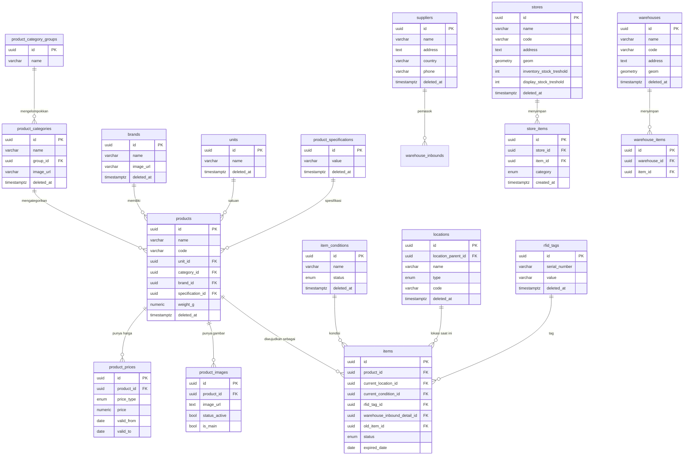

# ERD dan Kamus Data

Status: baseline v0.1
Tanggal: 2026-10-31
Sumber: `information_schema` database `veestore_dev1` dan `veestore_bo_dev`.

## 1. Catatan penting

1. Database operasional `veestore_dev1` berisi 132 tabel, 1.382 kolom, 317 foreign key, dan 241 nilai enum.
2. Skema operasional dikelola di luar repo ini. Penanda `goose_db_version` menunjukkan 102 versi migration Goose.
3. Database backoffice `veestore_bo_dev` berisi tabel role, permission, analytics, dan tabel internal lain.
4. Relasi lintas database, misalnya `roles.model_id` ke `users.id`, tidak punya foreign key. Relasi seperti ini digambarkan dengan garis putus-putus dan hanya berlaku secara logis.
5. Semua primary key memakai UUID kecuali tabel geografi yang memakai `code` dan beberapa tabel pivot.

## 2. Domain katalog dan master data

Catatan model:

- `products` adalah katalog. `items` adalah unit fisik per produk, memiliki kondisi, lokasi, dan RFID.
- `product_prices` memakai `price_type` (`base`, `store`, `ecommerce`) dengan masa berlaku.
- Stok toko dan gudang dihitung dari `store_items` dan `warehouse_items`, bukan dari kolom stok di `products`.

## 3. Domain inventori dan fulfillment

```mermaid
erDiagram
    suppliers ||--o{ warehouse_inbounds : "mengirim"
    warehouses ||--o{ warehouse_inbounds : "menerima"
    warehouse_inbounds ||--o{ warehouse_inbound_details : "detail"
    products ||--o{ warehouse_inbound_details : "produk"
    warehouse_inbounds ||--o{ items : "menghasilkan item"
    warehouses ||--o{ warehouse_items : "stok gudang"
    items ||--o{ warehouse_items : "item"
    warehouses ||--o{ warehouse_outbounds : "mengirim"
    warehouse_outbounds ||--o{ warehouse_outbound_details : "detail"
    items ||--o{ warehouse_outbound_details : "item"
    items ||--o{ warehouse_qc : "diperiksa"
    item_conditions ||--o{ warehouse_qc : "kondisi"
    users ||--o{ warehouse_qc : "pemeriksa"
    warehouses ||--o{ warehouse_stock_opnames : "opname"
    locations ||--o{ warehouse_stock_opnames : "lokasi"
    warehouse_stock_opnames ||--o{ warehouse_stock_opname_details : "detail"
    items ||--o{ warehouse_stock_opname_details : "item"
    items ||--o{ warehouse_stock_opname_details : "scan"
    stores ||--o{ store_inbounds : "menerima"
    warehouses ||--o{ store_inbounds : "sumber"
    store_inbounds ||--o{ store_inbound_details : "detail"
    items ||--o{ store_inbound_details : "item"
    stores ||--o{ store_outbounds : "mengirim"
    store_outbounds ||--o{ store_outbound_details : "detail"
    items ||--o{ store_outbound_details : "item"
    items ||--o{ store_qc : "diperiksa"
    stores ||--o{ store_qc : "toko"
    stores ||--o{ store_opname_sessions : "opname"
    store_opname_sessions ||--o{ store_opname_session_items : "detail"
    products ||--o{ store_opname_session_items : "produk"
    products ||--o{ stock_reservations : "reservasi"
    store_carts ||--o{ stock_reservations : "keranjang"
    ecommerce_orders ||--o{ stock_reservations : "order"
    store_returns ||--o{ warehouse_inbounds : "retur masuk"
    store_returns ||--o{ store_outbounds : "retur keluar"

    warehouse_inbounds {
        uuid id PK
        uuid supplier_id FK
        uuid warehouse_id FK
        uuid created_by FK
        uuid received_by FK
        uuid store_return_id FK
        varchar invoice_number
        varchar delivery_order_number
        int quantity_item
        numeric grand_total
        enum inbound_type
        date received_date
    }
    warehouse_inbound_details {
        uuid id PK
        uuid warehouse_inbound_id FK
        uuid product_id FK
        int quantity
        date expired_date
        numeric price_idr
        numeric exchange_rate
    }
    warehouse_outbounds {
        uuid id PK
        uuid warehouse_id FK
        uuid user_id FK
        uuid courier_id FK
        uuid qc_passed_by FK
        varchar invoice_number
        varchar order_number
        enum order_ref
        enum outbound_type
        date shipment_date
        timestamptz qc_passed_at
    }
    warehouse_outbound_details {
        uuid id PK
        uuid warehouse_outbound_id FK
        uuid item_id FK
    }
    warehouse_qc {
        uuid id PK
        uuid warehouse_id FK
        uuid item_id FK
        uuid item_condition_id FK
        uuid performed_by FK
        enum qc_type
        enum status
        timestamptz performed_at
    }
    warehouse_stock_opnames {
        uuid id PK
        uuid warehouse_id FK
        uuid user_id FK
        uuid location_id FK
        uuid approved_by FK
        varchar code
        enum status
        timestamptz completed_at
    }
    warehouse_stock_opname_details {
        uuid id PK
        uuid warehouse_stock_opname_id FK
        uuid rfid_tag_id FK
        uuid move_to_location_id FK
        uuid change_to_condition_id FK
        enum status
        timestamptz scanned_at
    }
    store_inbounds {
        uuid id PK
        uuid warehouse_source_id FK
        uuid store_id FK
        uuid received_by FK
        uuid order_id FK
        varchar invoice_number
        int quantity_item
        numeric grand_total
        enum qc_status
    }
    store_inbound_details {
        uuid id PK
        uuid store_inbound_id FK
        uuid item_id FK
        bool has_been_qc
    }
    store_outbounds {
        uuid id PK
        uuid store_id FK
        uuid ecommerce_order_id FK
        uuid store_cart_id FK
        uuid courier_id FK
        uuid payment_id FK
        uuid store_return_id FK
        enum outbound_type
        date shipment_date
    }
    store_outbound_details {
        uuid id PK
        uuid store_outbound_id FK
        uuid item_id FK
        uuid rfid_tag_id FK
        uuid rfid_releaser_user_id FK
    }
    store_qc {
        uuid id PK
        uuid store_id FK
        uuid item_id FK
        uuid item_condition_id FK
        uuid performed_by FK
        uuid store_inbound_id FK
        enum qc_type
        timestamptz performed_at
    }
    store_opname_sessions {
        uuid id PK
        uuid store_id FK
        uuid location_id FK
        uuid created_by FK
        uuid approved_by FK
        uuid rejected_by FK
        varchar name
        enum type
        enum status
        timestamptz started_at
        timestamptz finished_at
    }
    store_opname_session_items {
        uuid id PK
        uuid opname_session_id FK
        uuid product_id FK
        uuid location_id FK
        int system_stock
        int physical_stock
        text discrepancy_reason
    }
    stock_reservations {
        uuid id PK
        uuid product_id FK
        int quantity
        enum status
        timestamptz expires_at
    }
    store_returns {
        uuid id PK
        uuid store_id FK
        uuid warehouse_id FK
        uuid approved_by FK
        uuid created_by FK
        varchar return_number
        enum status
        timestamptz shipped_at
        timestamptz received_at
    }
```

Catatan model:

- Barang bergerak sebagai `items`, bukan sebagai kuantitas produk.
- Inbound gudang membentuk `items` baru. Outbound memindahkan `items` ke toko atau ecommerce.
- Opname gudang memakai `warehouse_stock_opname_details`, sedangkan opname toko memakai `store_opname_sessions` dan `store_opname_session_items`.
- `store_returns` menghubungkan alur retur toko ke gudang.

## 4. Domain penjualan toko dan ecommerce

```mermaid
erDiagram
    customers ||--o{ store_customer_visits : "berkunjung"
    stores ||--o{ store_customer_visits : "menerima"
    store_customer_visits ||--o{ store_carts : "membuat"
    stores ||--o{ store_carts : "keranjang"
    customers ||--o{ store_carts : "pemilik"
    store_carts ||--o{ store_cart_details : "detail"
    items ||--o{ store_cart_details : "item"
    product_prices ||--o{ store_cart_details : "harga"
    discounts ||--o{ store_cart_details : "diskon"
    vouchers ||--o{ store_carts : "voucher"
    store_customer_visits ||--o{ store_visit_payments : "pembayaran"
    payments ||--o{ store_visit_payments : "payment"
    cashier_sessions ||--o{ store_visit_payments : "sesi kasir"
    users ||--o{ store_visit_payments : "kasir"
    stores ||--o{ cashier_sessions : "toko"
    users ||--o{ cashier_sessions : "kasir"
    cashier_sessions ||--o{ cashier_session_payment_summaries : "ringkasan"
    payment_methods ||--o{ cashier_session_payment_summaries : "metode"
    payments ||--o{ payment_details : "detail"
    payment_methods ||--o{ payment_details : "metode"
    customers ||--o{ ecommerce_orders : "order"
    payments ||--o{ ecommerce_orders : "pembayaran"
    stores ||--o{ ecommerce_orders : "diproses toko"
    warehouses ||--o{ ecommerce_orders : "diproses gudang"
    ecommerce_orders ||--o{ ecommerce_order_details : "detail"
    products ||--o{ ecommerce_order_details : "produk"
    product_prices ||--o{ ecommerce_order_details : "harga"
    customers ||--o{ ecommerce_carts : "keranjang"
    products ||--o{ ecommerce_carts : "produk"
    order_shipments ||--o{ order_shipment_events : "event"
    payments ||--o{ store_receivable_invoices : "pembayaran piutang"
    store_receivable_invoices ||--o{ store_receivable_payment_allocations : "alokasi"

    customers {
        uuid id PK
        uuid user_id FK
        varchar name
        varchar email
        varchar wa_number
        enum gender
        date date_of_birth
        varchar referral_code
        varchar province_code FK
        varchar regency_code FK
        varchar district_code FK
        varchar village_code FK
        bool is_guest
        timestamptz deleted_at
    }
    store_customer_visits {
        uuid id PK
        uuid store_id FK
        uuid customer_id FK
        varchar visit_code
        enum status
        enum payment_status
        enum visit_type
        timestamptz check_in_at
        timestamptz check_out_at
    }
    store_carts {
        uuid id PK
        uuid store_id FK
        uuid customer_id FK
        uuid visit_id FK
        uuid voucher_id FK
        enum status
        numeric voucher_discount
        numeric point_amount
    }
    store_cart_details {
        uuid id PK
        uuid cart_id FK
        uuid item_id FK
        uuid product_price_id FK
        uuid discount_id FK
        uuid void_transaction_id FK
        numeric product_price_amount
        numeric discount_amount
        varchar void_status
    }
    payments {
        uuid id PK
        numeric total_amount
        numeric paid_amount
        numeric change_amount
        numeric tax_amount
        enum status
        enum app
        varchar transaction_number
        varchar void_status
        timestamptz completed_at
        timestamptz deleted_at
    }
    payment_methods {
        uuid id PK
        varchar name
        enum type
        timestamptz deleted_at
    }
    payment_details {
        uuid id PK
        uuid payment_id FK
        uuid payment_method_id FK
        numeric amount
        enum status
        varchar transaction_ref
    }
    store_visit_payments {
        uuid id PK
        uuid visit_id FK
        uuid payment_id FK
        uuid cashier_user_id FK
        uuid cashier_session_id FK
        varchar source
        text note
    }
    cashier_sessions {
        uuid id PK
        uuid store_id FK
        uuid user_id FK
        uuid closed_by FK
        varchar session_number
        enum status
        numeric opening_cash
        numeric expected_cash
        numeric actual_cash
        numeric difference
        numeric total_sales
        int total_transactions
    }
    cashier_session_payment_summaries {
        uuid id PK
        uuid cashier_session_id FK
        uuid payment_method_id FK
        numeric total_amount
        int transaction_count
    }
    ecommerce_orders {
        uuid id PK
        varchar order_number
        uuid customer_id FK
        uuid payment_id FK
        uuid handled_by_store_id FK
        uuid handled_by_warehouse_id FK
        uuid shipping_address_snapshot_id FK
        enum status
        numeric sub_total
        numeric discount_total
        numeric grand_total
        numeric payment_fee
    }
    ecommerce_order_details {
        uuid id PK
        uuid ecommerce_order_id FK
        uuid product_id FK
        uuid product_price_id FK
        int quantity
        numeric product_price
        numeric total_discount
        numeric total_price
    }
    ecommerce_carts {
        uuid id PK
        uuid customer_id FK
        uuid product_id FK
        int quantity
    }
    order_shipments {
        uuid id PK
        varchar reference_type
        uuid reference_id
        varchar handler_type
        uuid handler_id
        varchar provider
        varchar tracking_id
        varchar waybill_id
        varchar courier_company
        varchar integration_status
        jsonb request_payload
        jsonb provider_response
    }
    order_shipment_events {
        uuid id PK
        uuid shipment_id FK
        varchar event_type
        varchar provider_status
        timestamptz occurred_at
        jsonb payload
    }
    store_receivable_invoices {
        uuid id PK
        uuid store_id FK
        uuid cart_id FK
        uuid visit_id FK
        uuid customer_id FK
        uuid partner_id FK
        varchar invoice_number
        numeric amount
        numeric paid_amount
        enum status
        date due_date
    }
    store_receivable_payment_allocations {
        uuid id PK
        uuid store_id FK
        uuid payment_id FK
        uuid invoice_id FK
        numeric amount
    }
```

Catatan model:

- Transaksi toko berpusat pada `store_customer_visits`. Satu kunjungan bisa punya beberapa keranjang dan pembayaran.
- `payments` dipakai bersama oleh toko dan ecommerce, dibedakan lewat kolom `app`.
- `store_cart_details` mengunci harga dan diskon saat transaksi, sehingga perubahan master data tidak mengubah histori.
- `order_shipments` memakai referensi polimorfik `reference_type` dan `reference_id`, bukan foreign key.

## 5. Domain loyalty, promosi, dan partner

```mermaid
erDiagram
    customers ||--o{ customer_memberships : "memiliki"
    memberships ||--o{ customer_memberships : "tier"
    memberships ||--o{ membership_benefits : "benefit"
    customers ||--o{ customer_loyalty_points : "saldo"
    customer_loyalty_points ||--o{ customer_loyalty_point_mutations : "mutasi"
    customers ||--o{ customer_loyalty_point_mutations : "transaksi poin"
    customers ||--o{ referrals : "referrer"
    customers ||--o{ referrals : "referee"
    promos ||--o{ discounts : "menghasilkan"
    discounts ||--o{ discount_products : "produk"
    discounts ||--o{ discount_rules : "aturan"
    products ||--o{ discount_products : "produk"
    products ||--o{ discount_rules : "syarat produk"
    vouchers ||--o{ voucher_codes : "kode"
    vouchers ||--o{ voucher_usages : "pemakaian"
    voucher_codes ||--o{ voucher_usages : "kode"
    customers ||--o{ voucher_usages : "pengguna"
    store_carts ||--o{ voucher_usages : "keranjang"
    ecommerce_orders ||--o{ voucher_usages : "order"
    partners ||--o{ partner_invoice_batches : "tagihan"
    partner_invoice_batches ||--o{ partner_invoice_batch_items : "item"
    store_receivable_invoices ||--o{ partner_invoice_batch_items : "invoice"
    partners ||--o{ store_receivable_invoices : "piutang"
    partners ||--o{ partner_fraud_alerts : "fraud"
    partner_invoice_batches ||--o{ partner_fraud_alerts : "batch"
    store_receivable_invoices ||--o{ partner_fraud_alerts : "invoice"
    customers ||--o{ fraud_alerts : "fraud"
    users ||--o{ fraud_alerts : "reviewer"

    memberships {
        uuid id PK
        varchar name
        numeric earning_multiplier
        numeric min_spend_treshold
        int sort_order
        timestamptz deleted_at
    }
    customer_memberships {
        uuid id PK
        uuid customer_id FK
        uuid membership_id FK
        uuid previous_membership_id FK
        enum status
        numeric total_spend_12_month
        timestamptz tier_valid_until
    }
    membership_benefits {
        uuid id PK
        uuid membership_id FK
        varchar name
        numeric value
        varchar type
        timestamptz deleted_at
    }
    customer_loyalty_points {
        uuid id PK
        uuid customer_id FK
        numeric balance
    }
    customer_loyalty_point_mutations {
        uuid id PK
        uuid customer_id FK
        uuid customer_loyalty_point_id FK
        uuid ref_id
        enum mutation_type
        enum ref
        numeric points
        numeric balance_after
        numeric used_points
        bool has_expiration
        timestamptz expired_at
    }
    referrals {
        uuid id PK
        uuid referrer_id FK
        uuid referee_id FK
        varchar code_used
        enum status
    }
    promos {
        uuid id PK
        varchar name
        uuid store_id FK
        bool all_store
        varchar code
        date start_date
        date end_date
        timestamptz deleted_at
    }
    discounts {
        uuid id PK
        uuid promo_id FK
        varchar name
        enum type
        numeric value
        numeric max_discount
        numeric min_purchase
        int priority
        bool combinable
    }
    discount_products {
        uuid discount_id FK
        uuid product_id FK
        enum applied_to
        uuid store_id FK
    }
    discount_rules {
        uuid id PK
        uuid discount_id FK
        uuid scope_product_id FK
        uuid get_product_id FK
        enum rule_type
        int threshold_qty
        numeric threshold_amount
        varchar override_type
        numeric override_value
        jsonb metadata
        bool is_active
    }
    vouchers {
        uuid id PK
        uuid store_voucher_request_id FK
        varchar code
        varchar name
        enum type
        enum context
        enum distribution_type
        numeric value
        numeric max_discount
        numeric min_purchase
        int usage_limit
        int usage_count
        bool is_active
    }
    voucher_codes {
        uuid id PK
        uuid voucher_id FK
        varchar code
        bool is_active
        timestamptz expires_at
    }
    voucher_usages {
        uuid id PK
        uuid voucher_id FK
        uuid voucher_code_id FK
        uuid customer_id FK
        uuid store_cart_id FK
        uuid ecommerce_order_id FK
        numeric discount_amount
        timestamptz used_at
    }
    partners {
        uuid id PK
        varchar name
        numeric default_credit_limit
        varchar billing_cycle
        varchar late_fee_type
        numeric late_fee_rate
        varchar status
        timestamptz deleted_at
    }
    partner_credit_tiers {
        uuid id PK
        int tier_level
        varchar tier_name
        numeric credit_limit_multiplier
        numeric max_per_transaction
        numeric min_on_time_payments
        numeric min_payment_score
        timestamptz deleted_at
    }
    partner_invoice_batches {
        uuid id PK
        uuid partner_id FK
        uuid processed_by FK
        varchar batch_number
        date billing_period_start
        date billing_period_end
        date due_date
        numeric total_amount
        numeric total_paid
        varchar status
    }
    partner_invoice_batch_items {
        uuid id PK
        uuid batch_id FK
        uuid invoice_id FK
        numeric amount
        numeric late_fee
    }
    partner_fraud_alerts {
        uuid id PK
        uuid partner_id FK
        uuid batch_id FK
        uuid invoice_id FK
        uuid employee_code_id FK
        uuid reviewed_by FK
        enum severity
        enum status
    }
    fraud_alerts {
        uuid id PK
        uuid customer_id FK
        uuid cashier_user_id FK
        uuid store_id FK
        uuid related_point_mutation_id FK
        uuid reviewed_by FK
        enum severity
        enum status
        varchar alert_type
        jsonb metadata
    }
```

Catatan model:

- Poin pelanggan disimpan di `customer_loyalty_points`, sedangkan histori ada di `customer_loyalty_point_mutations`.
- Promo menghasilkan satu atau banyak `discounts`. Aturan kompleks ada di `discount_rules`.
- Voucher bisa berupa kode tunggal atau kode unik lewat `voucher_codes`.
- Piutang partner memakai `store_receivable_invoices`, lalu dialokasikan ke pembayaran lewat `store_receivable_payment_allocations`.

## 6. Domain backoffice, auth, workforce, dan analytics

```mermaid
erDiagram
    users ||..o{ model_has_roles : "lintas database"
    roles ||--o{ model_has_roles : "role"
    roles ||--o{ role_has_permissions : "permission"
    permissions ||--o{ role_has_permissions : "permission"
    users ||--o{ model_has_permissions : "izin langsung"
    permissions ||--o{ model_has_permissions : "permission"
    stores ||--o{ store_attendance_shifts : "shift"
    stores ||--o{ store_attendances : "absensi"
    users ||--o{ store_attendances : "karyawan"
    store_attendance_shifts ||--o{ store_attendances : "shift"
    stores ||--o{ store_shift_schedules : "jadwal"
    store_shift_schedules ||--o{ store_shift_schedule_details : "detail"
    users ||--o{ store_shift_schedule_details : "karyawan"
    store_attendance_shifts ||--o{ store_shift_schedule_details : "shift"
    analytics_model_runs ||--o{ analytics_sales_forecasts : "menghasilkan"
    analytics_model_runs ||--o{ analytics_stock_recommendations : "menghasilkan"
    products ||..o{ analytics_sales_forecasts : "lintas database"
    stores ||..o{ analytics_sales_forecasts : "lintas database"
    warehouses ||..o{ analytics_sales_forecasts : "lintas database"
    products ||..o{ analytics_stock_recommendations : "lintas database"
    stores ||..o{ analytics_stock_recommendations : "lintas database"
    users ||..o{ analytics_stock_recommendations : "reviewer"

    users {
        uuid id PK
        varchar name
        varchar username
        varchar email
        varchar password
        bool ecommerce_access
        bool wms_access
        bool backoffice_access
        bool store_access
        jsonb face_descriptor
        timestamptz deleted_at
    }
    roles {
        uuid id PK
        varchar name
        varchar guard_name
    }
    permissions {
        uuid id PK
        varchar name
        varchar guard_name
    }
    model_has_roles {
        uuid role_id FK
        varchar model_type
        uuid model_id
    }
    model_has_permissions {
        uuid permission_id FK
        varchar model_type
        uuid model_id
    }
    role_has_permissions {
        uuid role_id FK
        uuid permission_id FK
    }
    store_attendance_shifts {
        uuid id PK
        uuid store_id FK
        varchar name
        varchar code
        time start_time
        time end_time
        bool is_active
    }
    store_attendances {
        uuid id PK
        uuid store_id FK
        uuid user_id FK
        uuid attendance_shift_id FK
        date date
        timestamptz clock_in_at
        timestamptz clock_out_at
        enum status
    }
    store_shift_schedules {
        uuid id PK
        uuid store_id FK
        uuid approved_by FK
        uuid created_by FK
        uuid updated_by FK
        varchar schedule_month
        enum status
        timestamptz submitted_at
        timestamptz approved_at
    }
    store_shift_schedule_details {
        uuid id PK
        uuid store_shift_schedule_id FK
        uuid user_id FK
        uuid attendance_shift_id FK
        date schedule_date
        bool is_day_off
        bool is_national_holiday
    }
    analytics_model_runs {
        uuid id PK
        varchar model_name
        varchar model_type
        varchar model_version
        varchar status
        date training_from
        date training_to
        jsonb parameters
        jsonb metrics
        text error_message
        timestamptz started_at
        timestamptz completed_at
    }
    analytics_sales_forecasts {
        uuid id PK
        uuid model_run_id FK
        date forecast_date
        varchar channel
        uuid store_id
        uuid warehouse_id
        uuid product_id
        int horizon_days
        numeric predicted_qty
        numeric lower_qty
        numeric upper_qty
        numeric predicted_revenue
        numeric confidence
    }
    analytics_stock_recommendations {
        uuid id PK
        uuid model_run_id FK
        uuid store_id
        uuid product_id
        int current_stock
        int reserved_stock
        numeric forecast_qty_7d
        numeric average_daily_demand
        int safety_stock
        int recommended_qty
        varchar risk_level
        varchar status
        uuid reviewed_by
        timestamptz reviewed_at
        text review_notes
    }
```

Catatan model:

- `users` ada di `veestore_dev1`. `roles`, `permissions`, dan pivot ada di `veestore_bo_dev`. Garis putus-putus menandakan relasi logis tanpa foreign key.
- `analytics_*` ada di `veestore_bo_dev`, tetapi `store_id`, `product_id`, `warehouse_id`, dan `reviewed_by` merujuk ke tabel di `veestore_dev1`.
- Tabel internal backoffice lain, seperti `business_audit_logs`, `report_exports`, `report_export_jobs`, `notification_reads`, dan `app_settings`, tidak selalu punya foreign key. `business_audit_logs` menyimpan `user_id` dan `user_name` sebagai snapshot.

## 7. Kamus tabel inti

| Tabel | Fungsi | Kunci relasi |
|---|---|---|
| products | Katalog produk | category_id, brand_id, unit_id, specification_id |
| items | Unit fisik produk | product_id, current_location_id, current_condition_id, rfid_tag_id |
| product_prices | Harga per tipe dan periode | product_id |
| store_items | Stok fisik di toko | store_id, item_id |
| warehouse_items | Stok fisik di gudang | warehouse_id, item_id |
| warehouse_inbounds | Penerimaan gudang | supplier_id, warehouse_id, store_return_id |
| warehouse_outbounds | Pengeluaran gudang | warehouse_id, courier_id |
| store_inbounds | Penerimaan toko | store_id, warehouse_source_id, order_id |
| store_outbounds | Pengeluaran toko | store_id, ecommerce_order_id, store_cart_id |
| store_customer_visits | Kunjungan dan transaksi toko | store_id, customer_id |
| store_carts | Keranjang transaksi toko | visit_id, store_id, customer_id, voucher_id |
| store_cart_details | Detail barang dan harga transaksi | cart_id, item_id, product_price_id |
| payments | Pembayaran toko dan ecommerce | void_transaction_id |
| cashier_sessions | Sesi kasir | store_id, user_id |
| ecommerce_orders | Order ecommerce | customer_id, payment_id, handled_by_store_id, handled_by_warehouse_id |
| ecommerce_order_details | Detail order ecommerce | ecommerce_order_id, product_id, product_price_id |
| customers | Data pelanggan | user_id, kode wilayah |
| memberships | Tier membership | - |
| customer_memberships | Membership aktif pelanggan | customer_id, membership_id |
| customer_loyalty_points | Saldo poin | customer_id |
| customer_loyalty_point_mutations | Histori poin | customer_id, customer_loyalty_point_id |
| promos | Kampanye promo | store_id |
| discounts | Diskon dan aturan dasar | promo_id |
| discount_rules | Aturan diskon kompleks | discount_id, scope_product_id, get_product_id |
| vouchers | Voucher | store_voucher_request_id |
| voucher_codes | Kode voucher | voucher_id |
| voucher_usages | Pemakaian voucher | voucher_id, voucher_code_id, customer_id, store_cart_id, ecommerce_order_id |
| partners | Partner paylater | - |
| store_receivable_invoices | Piutang partner | store_id, cart_id, visit_id, customer_id, partner_id |
| store_returns | Retur toko | store_id, warehouse_id |
| void_transactions | Void transaksi | payment_id, visit_id, store_id, cashier_user_id |
| store_attendances | Absensi karyawan toko | store_id, user_id, attendance_shift_id |
| analytics_model_runs | Riwayat job analytics | - |
| analytics_sales_forecasts | Hasil forecast | model_run_id, store_id, warehouse_id, product_id |
| analytics_stock_recommendations | Rekomendasi restock | model_run_id, store_id, product_id, reviewed_by |

## 8. Enum penting

| Enum | Nilai |
|---|---|
| item_status | warehouse_stock, in_delivery, store_stock, sold, warehouse_processing, store_processing, missing, unknown, returned, reserved, damaged, destroyed, qc_hold, store_display, in_transaction, returned_from_void, repaired, warehouse_waiting |
| ecommerce_order_status | pending, paid, processed, shipped, received, cancelled, packing |
| store_visit_status | active, completed, cancelled, abandoned, on_hold |
| store_cart_status | pending, paid, failed, cancelled, on_hold |
| payment_main_status | pending, paid, failed, cancelled |
| store_order_status | draft, requested, approved, rejected, processing, shipped, received, cancelled, packing, partial_approved, partial_received |
| store_return_status | shipped, pending_approval, draft, approved, partial_approved, rejected, received, close, requested, packing, packing_completed |
| warehouse_outbound_type | ecommerce, destroy, transfer, return_to_supplier, store |
| store_outbound_type | ecommerce, destroy, transfer, return_to_supplier, store |
| discount_rule_type | qty_tier_percent, qty_tier_fixed, bogo, bundle, cap_per_tx, cap_per_day, time_window, weekday |
| voucher_context | ecommerce_checkout, ecommerce_shipping, store_checkout, store_customer_return |
| loyalty_mutation_type | earn, redeem, expire, adjust, referral_register, referral_first_tx, void_reversal |
| void_transaction_status | pending, approved, rejected, expired |
| fraud_alert_severity | low, medium, high, critical |
| store_opname_status | draft, in_progress, completed |
| warehouse_stock_opname_status | draft, in_progress, completed |
